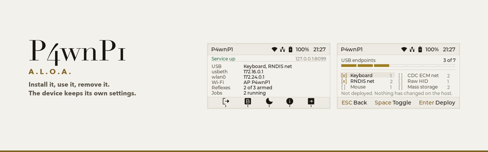
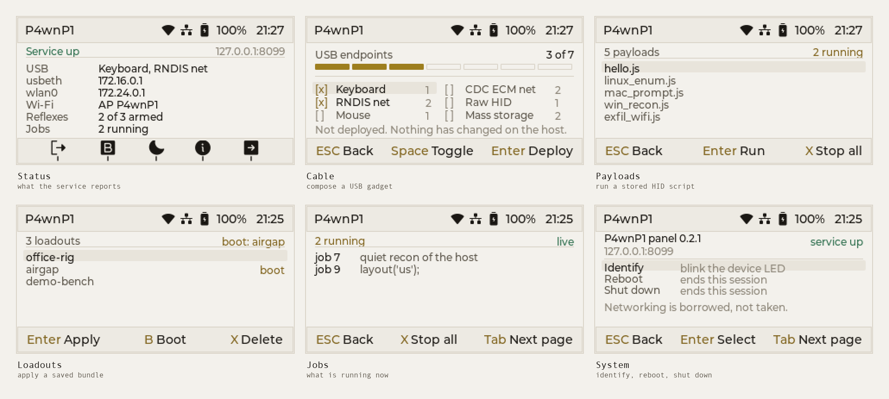
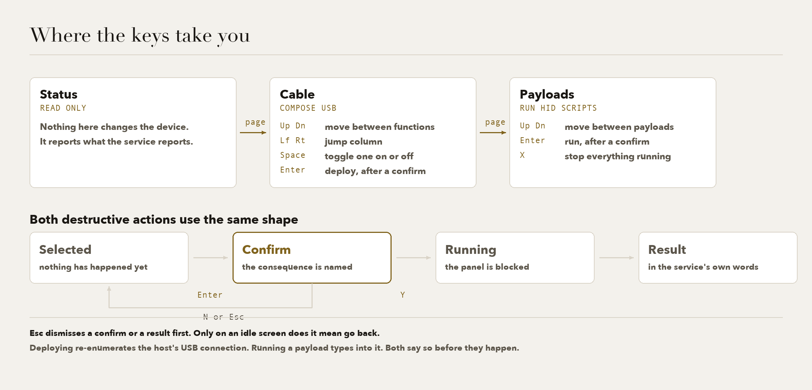

<p align="center">
  <picture>
    <source media="(prefers-color-scheme: dark)" srcset="images/banner-dark.png">
    
  </picture>
</p>

<p align="center">
  <a href="https://github.com/at0m-b0mb/P4wnP1-CardputerZero/releases/latest"></a>
  <a href="LICENSE"></a>
  
  
  
  
</p>

An on-device panel for [P4wnP1 A.L.O.A.](https://github.com/at0m-b0mb/P4wnP1_aloa) running on
an M5Stack CardputerZero, packaged as an ordinary Debian package.

**The point is that the device does not need a different SD card to become a USB rig.** It
installs onto the stock CardputerZero OS, it removes cleanly, and while it is not in use the
device's own Wi-Fi settings keep working.

## Install

Grab the package from [the latest release](https://github.com/at0m-b0mb/P4wnP1-CardputerZero/releases/latest)
and install it on the device:

```bash
sudo apt install ./P4wnP1_0.2.1_rev1_arm64.deb
```

It appears in APPLaunch as **P4wnP1**. `apt remove` leaves the device as it was found; `apt
purge` additionally removes `/etc/p4wnp1_panel.conf`. The current release is marked a
**pre-release** because it has not yet run on a CardputerZero — see
[Not yet verified on hardware](#not-yet-verified-on-hardware).

<p align="center">
  <picture>
    <source media="(prefers-color-scheme: dark)" srcset="images/screens-dark.png">
    
  </picture>
</p>

## Three screens

| | |
|---|---|
| **Status** | what the service reports: USB composition, interface addresses, Wi-Fi, reflexes, running jobs |
| **Cable** | compose a USB gadget and watch the endpoint budget *before* deploying, not after |
| **Payloads** | list stored HID scripts and run one against the attached host |

### Where the keys take you

<p align="center">
  <picture>
    <source media="(prefers-color-scheme: dark)" srcset="images/flow-dark.png">
    
  </picture>
</p>

## The endpoint meter

The dwc2 controller has a small fixed number of USB endpoints and each gadget function spends
some of them. Compose past the budget and the deploy is refused — correctly — with a message
that names a number and not a thing to turn off:

```
Gadget Settings consume 8 out of 7 available USB Endpoints
```

So the panel counts first. A spent endpoint is drawn filled and a free one as an outline, so
the shape carries the reading and colour is not doing the work alone. The costs mirror
`endpointCost` in P4wnP1's `oled/client.go`, and the arithmetic is pinned by
`tests/test_gadget_budget.cpp` — including the case the upstream comment calls out: keyboard
plus both network functions plus mass storage is exactly 7, and raw HID on top of that is 8.

## What is honest about it

The panel reports what the service reports. **It cannot tell you whether an attached host
accepted what was typed into it**, and it does not pretend to.

- A reply that cannot be read counts as *did not answer*, never as *answered with nothing*.
  Those are different claims and the screen renders them differently.
- Where a value is unknown it says so, rather than showing a zero that would read as measured.
- Deploying re-enumerates the host's USB connection. Running a payload types into whatever is
  plugged in. Both are named before they happen, not after.
- A service that is down and a service that refuses are distinguished, because they call for
  different actions.
- **Status re-reads every five seconds, and says so.** The moment a read fails the headline stops
  saying *Service up*, the figures under it dim to mark them as last-known, and the corner reports
  how old they are. A panel left on a desk should not keep asserting something it checked once.
  Four states are distinguished and tested separately: never reached, live, *not refreshing* (the
  poll itself is wedged) and *lost the service* — the last two look alike and call for opposite
  actions.

## Not yet verified on hardware

The CardputerZero has not arrived. These are reasoned from the sources and are **not**
measured:

- that dwc2 enters device mode, and what the physical Host/Slave switch does in software
- the endpoint budget — 7 is the Pi Zero W figure and the CM0 may differ, so the panel shows
  it as the budget it is assuming
- what gadget mode costs: USB-A and wired Ethernet are expected to drop while Wi-Fi survives,
  because all three hang off one controller
- the first arm64 boot this codebase has ever had

[PLAN.md](PLAN.md) splits the remaining work into what can be finished without the device and
what cannot.

## Building

```bash
./run-tests.sh      # six host suites, none needing hardware
./build-deb.sh      # the arm64 .deb, built natively in a Debian container
./test-install.sh   # install it, inspect it, remove it, purge it
```

| suite | what it pins |
|---|---|
| `test_contrast` | every text pairing against WCAG AA, in both themes |
| `test_gadget_budget` | the endpoint arithmetic and cursor behaviour |
| `test_network_custody` | that NetworkManager is always handed back |
| `test_status_parse` | the service's reply shapes |
| `test_freshness` | that a reading is never shown as current once it stops being so |
| `test_rpc_integration` | the real client over a real socket, against `fake_service.py` |

The simulator runs on macOS and Linux:

```bash
cmake --preset darwin-arm64 && cmake --build --preset darwin-arm64-dbg
./build/darwin-arm64/Debug/p4wnp1_panel
```

`P4WNP1_API` and `P4WNP1_TOKEN` point the panel at a service; `app/tests/fake_service.py`
stands in for one while there is no device. `P4WNP1_PAGE`, `P4WNP1_DEPLOY_STATE` and
`P4WNP1_SHOT` capture any screen without driving the keypad, which is how every image in this
README was made.

**No cross toolchain is needed.** On Apple Silicon the container is already aarch64 Linux, so
its root is a valid sysroot and `-DCM0_SDK_ROOT=/` satisfies the CM0 branch of the build.

## Networking is borrowed, not seized

P4wnP1's `install.sh` disables NetworkManager outright, which on a CardputerZero breaks
LaunchWizard and Settings — both depend on it. So the panel stops it when a network mode is
**armed** and restores it on **disarm**, never at install time.

The property that matters is not "disarm restores it". It is that it is restored even when
disarm never happens: a crash, a kill, a power cut, or the package removed while armed.
Custody is recorded on disk *before* NetworkManager is stopped and cleared only *after* it is
running again, and the same reconciliation runs on startup, arm, disarm and removal.

## Publishing to the CardputerZero store

```bash
./check-store-manifest.py   # the store's policy, checked before anything uploads
```

The manifest passes. **The first release still cannot be submitted**: per
[AppBuilder's policy](https://github.com/CardputerZero/AppBuilder/blob/main/docs/APP_BUILDER_JSON.md),
a new app is not auto-merged — a short video of it running *on a real device* has to be
posted in the packages PR before a maintainer merges it. Version updates merge on validation
alone. So publishing waits on the hardware, not on the code.

Worth knowing if you scaffold your own app: the Template ships a **100×100** icon and the
store requires **128–512**, so a fresh scaffold fails that check until the icon is replaced.

## Licence

GPL-3.0-only, as a work built to drive GPL-3.0 software. Scaffolded from
[CardputerZero/Template](https://github.com/CardputerZero/Template), whose MIT notice is kept
in [app/NOTICE](app/NOTICE) for the parts that came from it.

Repo art is generated by [`tools_gen_banner.py`](tools_gen_banner.py) from the real 320×170
framebuffers in `app/screenshot/`, scaled by an integer factor only.
